# 🗑️ SmartBin: IoT Smart Waste Management


Connected bins that measure their own fill level and position, send it over **LoRa** to a gateway, which forwards it to **AWS IoT Core**. City agents follow everything on a **web dashboard**, and citizens use a **mobile app** to find the nearest bin that isn't full.

> End-of-studies project (PFE), DUT *Gestion Réseaux et Sécurité*, EST Fès (Université Sidi Mohammed Ben Abdellah), Dec 2025 – Mar 2026.

### ▶️ Try it online: **[wirvxy.github.io/smartbin-iot](https://wirvxy.github.io/smartbin-iot/)**
The [web dashboard](https://wirvxy.github.io/smartbin-iot/demo/) and the [mobile app](https://wirvxy.github.io/smartbin-iot/app/) run in the browser with demo data: 10 bins on real streets of Fès, one of them filling up live like the sensor node. Nothing to install.


---

## ✨ Features

| | |
|---|---|
| 📡 **Sensor node** | Ultrasonic fill-level measurement + GPS position, sent every few seconds over LoRa 433 MHz |
| 🛰️ **Gateway** | Heltec WiFi LoRa 32 V3 receives LoRa packets, adds RSSI/SNR, publishes to AWS IoT over MQTT/TLS with an X.509 device certificate |
| 🖥️ **Web dashboard** | Live bin gauges sorted by urgency, collection list, map, per-container history, automatic alerts above the threshold, PDF/CSV reports, user management with login audit |
| 📱 **Mobile app** | The nearest bin that still has room (fill level × distance), walking directions, district picker, map and statistics. Same design as the dashboard. Android, iOS and web |
| 🧪 **Demo mode** | 10 bins at real places in Fès, and a simulator that replays the exact sensor + gateway payload, so the whole system runs on a laptop without hardware or AWS |

## 🔧 The prototype

| Sensor node on breadboard | Mounted on a bin | Battery and LoRa antenna |
|---|---|---|
| 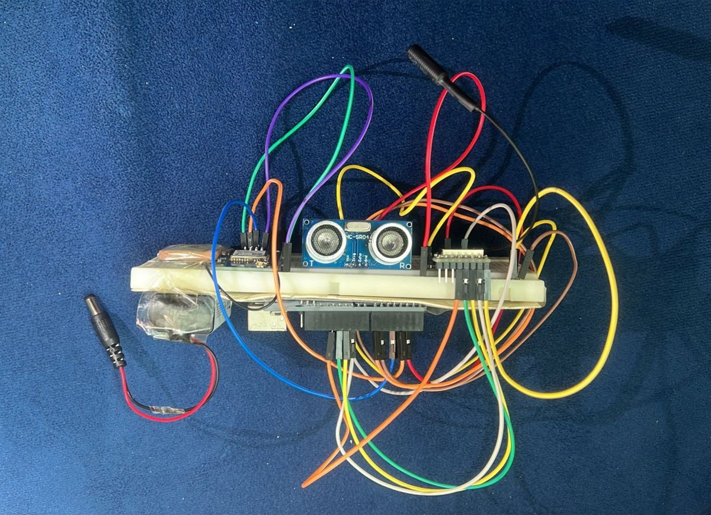 | 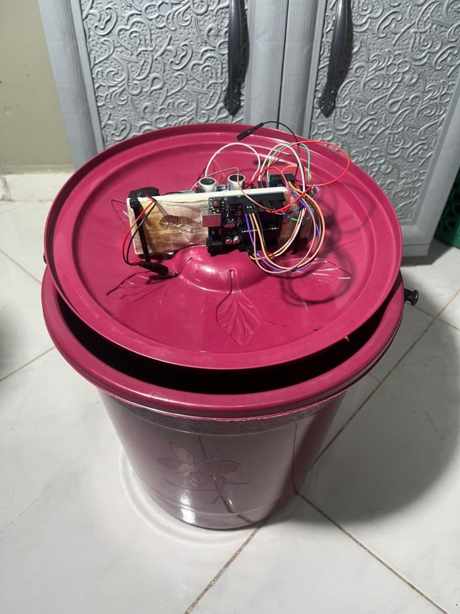 | 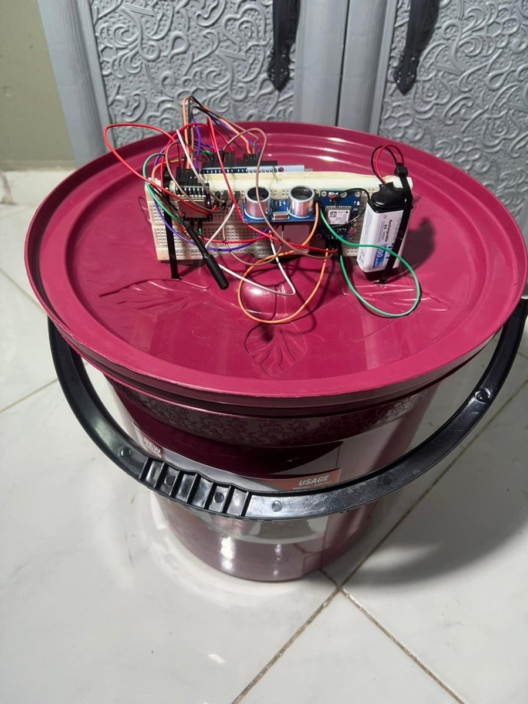 |

**Sensor node:** Arduino Uno, HC-SR04 ultrasonic sensor, NEO-6M GPS, SX1278 LoRa module at 433 MHz. **Gateway:** Heltec WiFi LoRa 32 V3 (ESP32-S3 + SX1262).

| Signal | Arduino pin | | Signal | Arduino pin |
|---|---|---|---|---|
| HC-SR04 TRIG | D7 | | LoRa NSS | D10 |
| HC-SR04 ECHO | D6 | | LoRa DIO0 | D2 |
| GPS TX → | D4 | | LoRa SCK / MISO / MOSI | D13 / D12 / D11 |
| GPS RX ← | D3 | | LoRa VCC | 3.3 V |

**End to end, on the real hardware:** the sensor node measures 58 % (12.9 cm), the gateway connects to Wi-Fi and AWS IoT, and the readings arrive on the `smartbin/data` topic with their RSSI and SNR.

| Sensor node serial output | Gateway serial output | AWS IoT Core, topic `smartbin/data` |
|---|---|---|
| 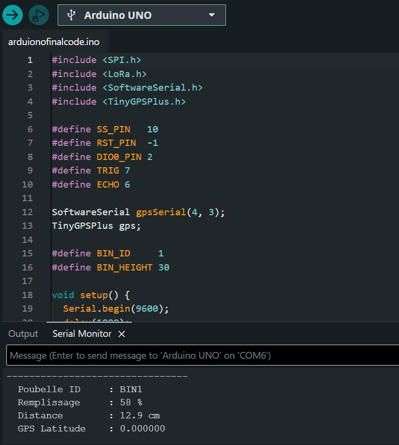 | 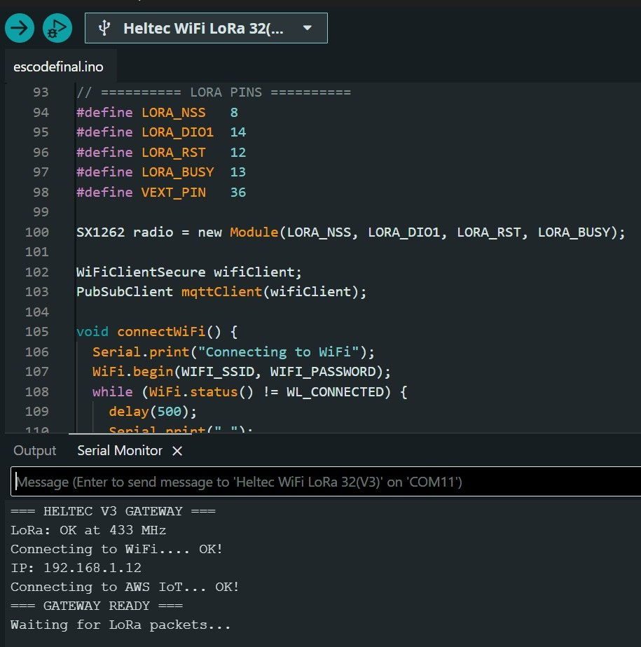 | 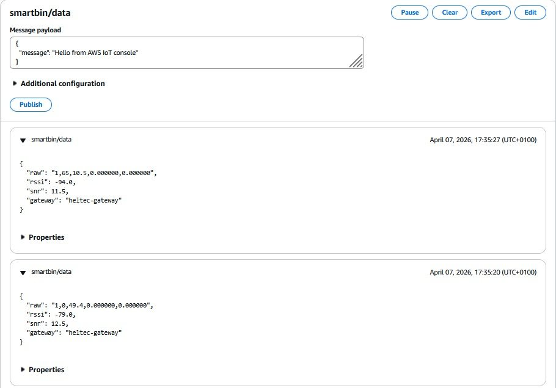 |

## 📸 Screenshots

### Web dashboard

The overview answers one question: **which bins need emptying now?** Every bin is drawn as a gauge at its live fill level, sorted fullest first, with its alert threshold as a dashed line. The page refreshes every 10 s, and a full bin can be marked as collected straight from the list.

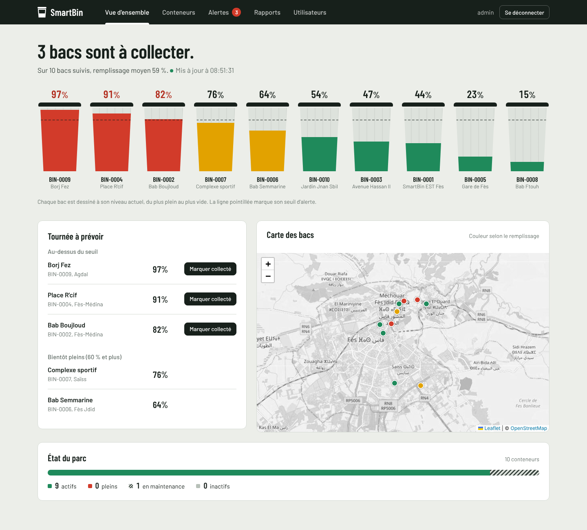

| Sign-in | Containers |
|---|---|
| 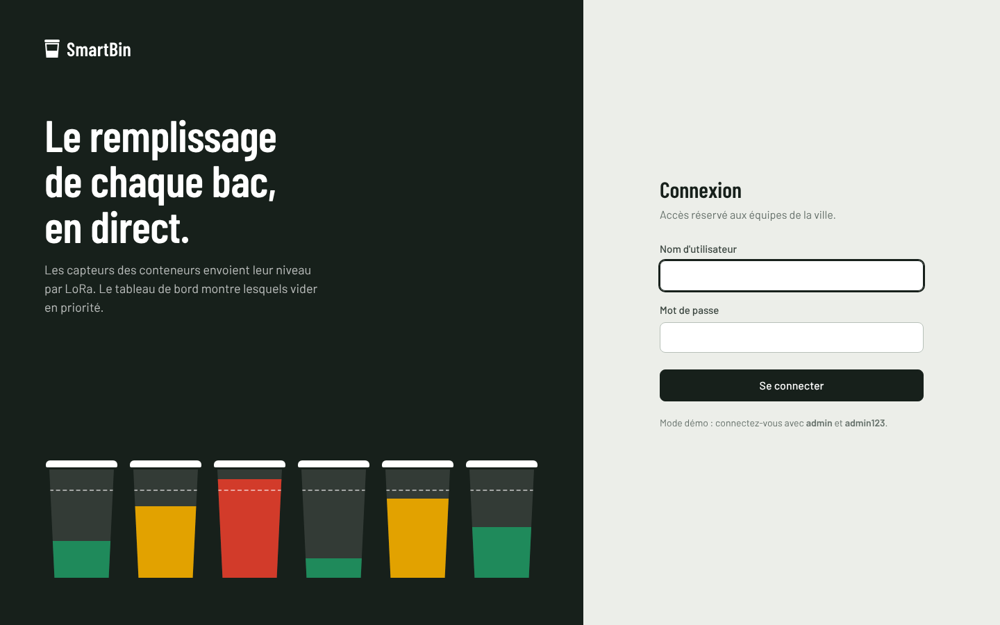 |  |

| Container detail (fed by the sensor node) | Automatic alerts |
|---|---|
| 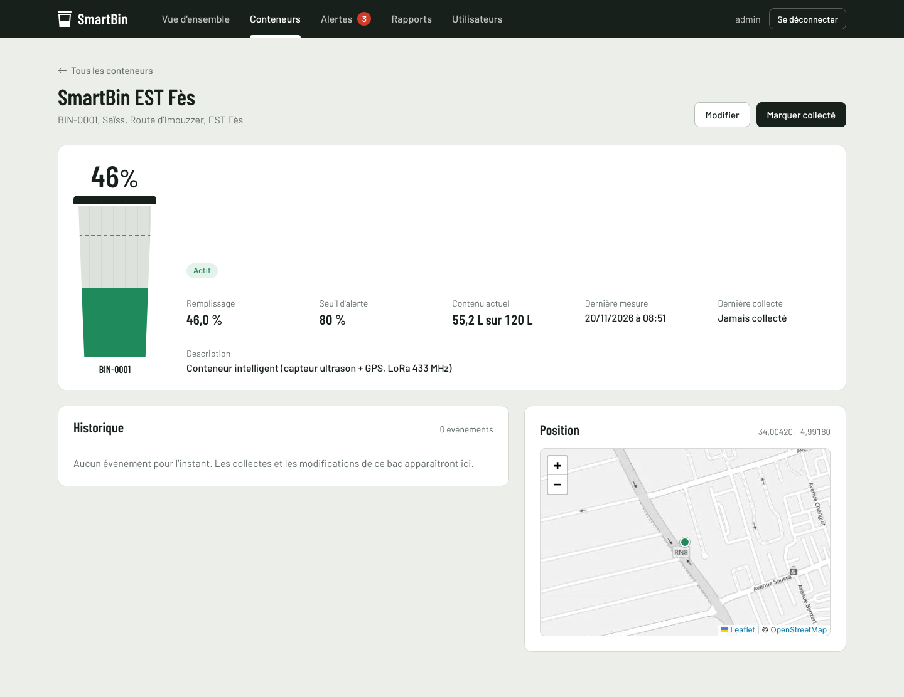 | 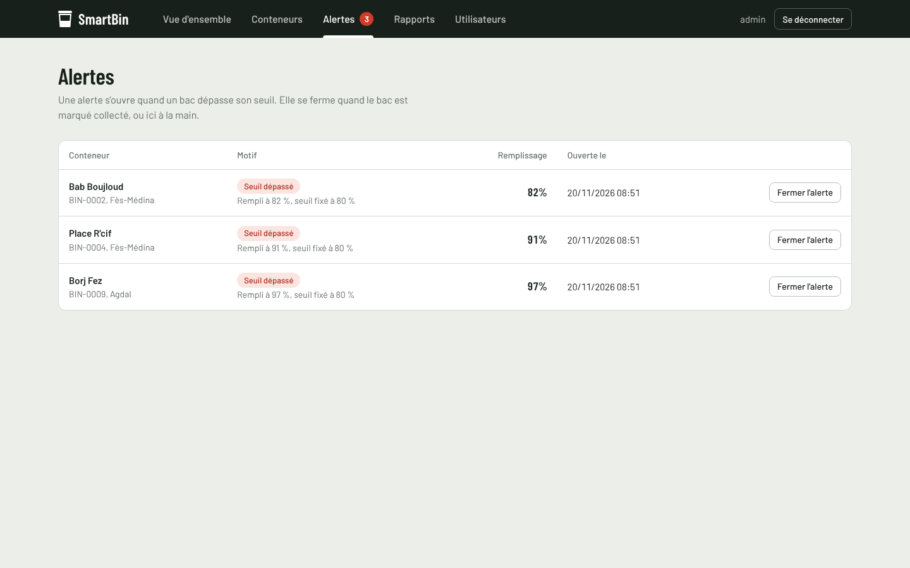 |

**Login audit:** every dashboard login attempt is logged, so brute-force attempts show up in red.

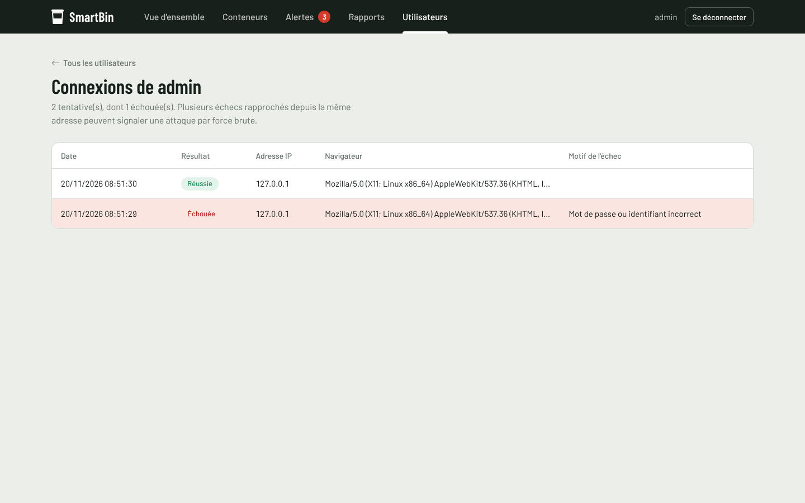

<details>
<summary><b>Design notes</b></summary>

- Colour only ever means fill state: green under 60 %, amber from 60 % to the threshold, red above it. Everything else is ink on a concrete grey, including the map, which is shown in greyscale so the bins stand out.
- Type is Barlow and Barlow Condensed, a family drawn from road and street signage, self-hosted so the dashboard works offline.
- Server-rendered with Thymeleaf (no build step), one stylesheet, and it works on a phone. If the map library can't load, the rest of the page keeps updating.
- The mobile app uses the same palette, fonts and bin gauges, so both read as one product.
</details>

### Mobile app
| Sign-in | Nearest bin with room | Map of Fès | Bin detail | District statistics |
|---|---|---|---|---|
| 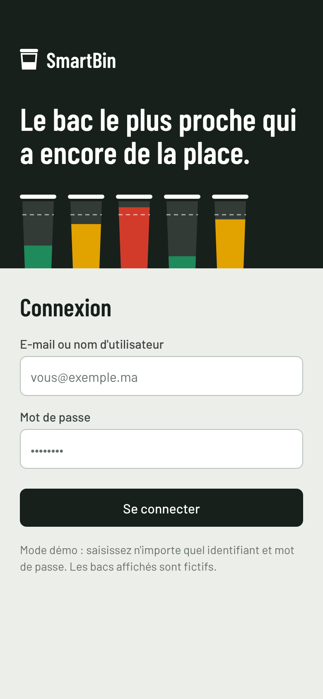 |  | 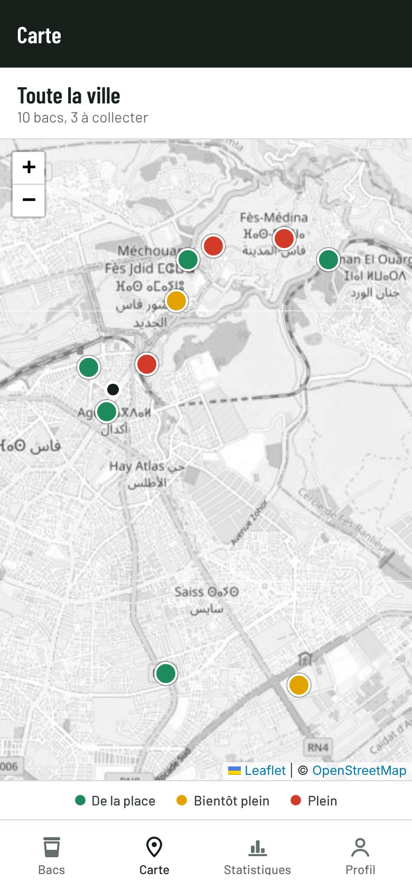 |  |  |

*Screenshots of the backend and the app in demo mode. Map data © OpenStreetMap contributors.*

## 🔄 How a reading travels

1. **Sensor node** (`firmware/sensor-node`) measures the distance to the waste, computes the fill %, reads the GPS and sends one LoRa packet:
   ```
   BIN_ID,FILL_%,DISTANCE_CM,LATITUDE,LONGITUDE      e.g.  1,45,16.5,34.004200,-4.991800
   ```
2. **Gateway** (`firmware/gateway`) wraps it as JSON and publishes it to `smartbin/data` on AWS IoT Core:
   ```json
   {"raw":"1,45,16.5,34.004200,-4.991800","rssi":-71.0,"snr":9.5,"gateway":"heltec-gateway"}
   ```
3. The reading is stored in `sensor_data`, and the latest value per bin is kept in `final_stats`.
4. **Backend** syncs `final_stats` into the containers every 5 s and raises an alert when a bin passes its threshold (80 % by default).
5. **Dashboard** and **mobile app** show the new level.

The backend also exposes `POST /api/iot/ingest` (authenticated with an `X-API-Key` header), which performs step 3 directly, so an AWS IoT Rule HTTP action or any test client can feed the system.

## 🔐 Security review

Before publishing, the project went through a security review. Issues found and fixed:

| Issue found | Fix |
|---|---|
| Wi-Fi password, AWS IoT **private key** and certificate hard-coded in the gateway sketch | Moved to a git-ignored `secrets.h` (template: `secrets.example.h`) |
| Production database host and password in `application.yml` | Environment variables + `prod` profile; in-memory H2 for the `demo` profile |
| Default JWT signing key in the config | `JWT_SECRET` env var; the app **refuses to start in prod** with dev defaults |
| CSRF protection disabled on the dashboard (session cookies) | CSRF re-enabled; Thymeleaf forms carry the token |
| Mobile API (`/api/mobile/**`) was public: anyone could read all data | Requires the JWT from `/api/auth/login` |
| Login endpoint answered `200 "Error: ..."` on bad credentials | Proper `401` with a generic message (no account enumeration) |
| Admin password reset to a hard-coded value on every restart | Default accounts created only once |
| No record of failed logins | Every attempt (success/failure, IP, user agent) stored and visible to admins |
| IoT data entry had no authentication | Shared API key, compared in constant time, plus payload validation |
| Logout worked with a plain `GET /logout`, so any page could sign a user out | Logout is a `POST` carrying the CSRF token |
| New user accounts defaulted to the Administrator role | New accounts default to the least-privileged role |

<details>
<summary><b>Functional bugs fixed during the same review</b></summary>

- Containers list and detail pages crashed (500): broken Thymeleaf ternary expressions and `T()` class references
- "Add user" page crashed: invalid quote escaping in a SpEL expression
- Editing a container crashed: infinite `toString()` recursion between JPA entities (Lombok `@Data`)
- Deleting a container with alerts, or a user with login history, failed on foreign-key constraints
- Alerts were never generated (the alert check was never scheduled)
- Dashboard charts showed hard-coded numbers, and its map/stats called a JWT-only API from a browser session, so markers never loaded
- User "History" page template was missing
- Mobile app pointed to a non-existent API (wrong port and paths), with no regions or statistics endpoints on the backend
- Creating a container with an ID already in use crashed with a 500; the form now shows the error and keeps what was typed
- Maps showed "API KEY REQUIRED": the CARTO basemap now needs a key. The maps use OpenStreetMap tiles instead
- The app's web map was an OpenStreetMap iframe centred on the user that showed none of the bins; it is now a Leaflet map with every bin
</details>

## 🚀 Run it

### Backend + dashboard (demo mode, no hardware needed)
Requirements: Java 17+, Maven.
```bash
cd backend
mvn spring-boot:run
```
Open http://localhost:8080 and sign in as `admin` / `admin123` (demo only). Bin **BIN-0001** fills up live from the simulated sensor and triggers an alert above 80 %.

### Mobile app
Requirements: Node 20+.
```bash
cd mobile
npm install
npx expo start                     # demo data, works offline

# connected to the backend (use your PC's IP on a phone):
EXPO_PUBLIC_DEMO_MODE=false EXPO_PUBLIC_API_URL=http://192.168.x.x:8080/api npx expo start
```
In demo mode any e-mail and password work. Connected to the backend, sign in with the same account (`admin@smartwaste.ma` / `admin123`).

### Firmware
Arduino IDE libraries: **LoRa** (Sandeep Mistry) and **TinyGPSPlus** for the sensor node; **RadioLib** and **PubSubClient** for the Heltec V3 gateway.
Copy `firmware/gateway/secrets.example.h` to `secrets.h` and fill in your Wi-Fi and AWS IoT credentials.

### Online demo (GitHub Pages)
`docs/` is served by GitHub Pages. `docs/demo/` is a snapshot of the real dashboard, and `docs/app/` is the web build of the app. To rebuild them:
```bash
# backend running in demo mode on :8080
python3 tools/demo/build_dashboard_demo.py http://localhost:8080
cd mobile && EXPO_BASE_URL=/smartbin-iot/app npx expo export --platform web --output-dir ../docs/app
```
`tools/demo/demo.js` stands in for the server in the snapshot: live data for the overview, the simulated sensor on BIN-0001, and the collect and close-alert buttons.

### Production (AWS)
| Variable | Purpose |
|---|---|
| `SPRING_PROFILES_ACTIVE=prod` | Use PostgreSQL instead of the demo database |
| `DB_URL`, `DB_USERNAME`, `DB_PASSWORD` | PostgreSQL / RDS connection |
| `JWT_SECRET` | 32+ character signing key |
| `ADMIN_PASSWORD`, `MANAGER_PASSWORD` | Initial accounts |
| `IOT_API_KEY` | Key required by `POST /api/iot/ingest` |

## 📁 Repository structure
```
firmware/
  sensor-node/   Arduino sketch: ultrasonic + GPS → LoRa
  gateway/       Heltec V3 sketch: LoRa → MQTT/TLS → AWS IoT
backend/         Spring Boot 3 (Java 17): dashboard, REST API, IoT sync, alerts
mobile/          Expo / React Native app
docs/            Online demo (GitHub Pages), architecture diagram, screenshots, hardware photos
tools/demo/      Builds the dashboard snapshot used by the online demo
```

## 👥 Team
Built by **Monssif El Haouari**, **Soufiane Ijer Amellal** and **Abdessamad Chakouch** at EST Fès, supervised by **Mme B. Frikh**.
